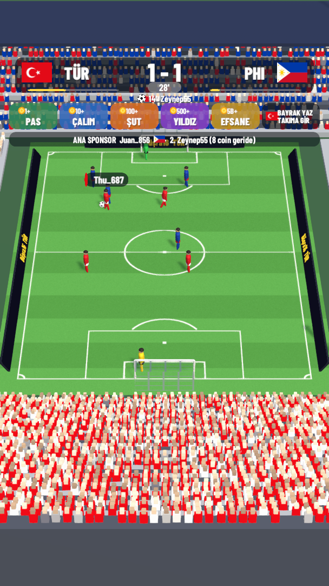
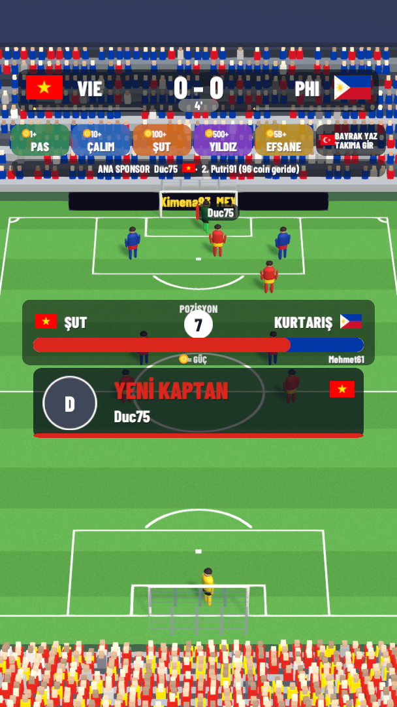
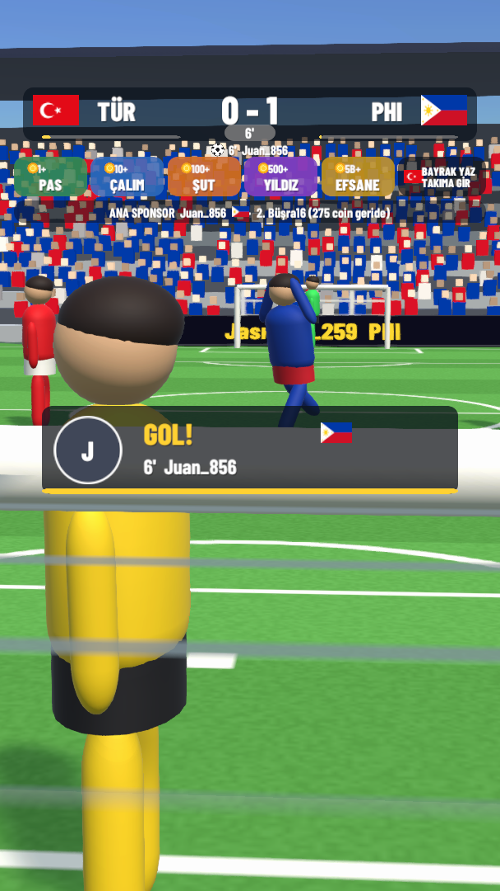

# Dünya Taraftar Kupası — TikTok LIVE futbol oyunu

TikTok canlı yayınında kendi kendine oynayan, izleyicilerin bayrak yazıp hediyeyle takımını desteklediği 3D futbol turnuvası.
Unity 6.3 LTS ile yapıldı. Kurallar tasarım dokümanındaki gibidir (bkz. `docs/TASARIM-NOTLARI.md`).

<p align="center">
  
  
  
</p>

## Çalıştırmak (tek tık)

`BASLAT.bat` dosyasına çift tıkla. Üç şey açılır:

1. **Köprü** (siyah pencere, kapatma): oyunu TikTok'a / simülatöre bağlar.
2. **Yayıncı paneli** (tarayıcı, `http://localhost:8787`): simülatör düğmeleri, maç durumu, teşekkür listesi, duraklat/atla.
3. **Oyun penceresi** (608×1080 dikey, ekranın sağ kenarında): TikTok LIVE Studio'nun yakalayacağı pencere.

Panelde **Kalabalık botu**'nu 50–200 izleyiciye getir ve maçın kendi kendine aktığını izle.
"K3 Şut", "K5 Efsane", "10 gül" gibi düğmelerle tek tek dene.

## Ekran düzeni (TikTok'a göre)

```
 %0  ┌────────────────────────┐  TikTok üst arayüzü (profil, izleyici sayısı)
 %10 │   SKOR TABELASI        │  bayraklar, skor, dakika, koreografi çubuğu, alev
 %17 │   HEDİYE REHBERİ       │  PAS · ÇALIM · ŞUT · YILDIZ · EFSANE · BAYRAK YAZ
 %22 │   SPONSOR SATIRI       │  Ana Sponsor + en yakın rakibi
     │   ┌──── SAHA ────┐     │  uzak kale + tribün (rakip)
 %40 │   │ POZİSYON ÇUBUĞU│    │  sadece pozisyon açıkken
 %50 │   │  DUYURU YUVASI │    │  GOL / Yıldız / Efsane / Kaptan / Sponsor (tek seferde bir)
     │   └──────────────┘     │  yakın kale
 %64 │  ~~ TikTok yorumları ~~│  burada sadece tribün/kalabalık var (süs)
 %92 │  TikTok düğmeleri      │
     └────────────────────────┘
```

TikTok hediye bildirimlerini ("X gül gönderdi") zaten kendisi gösteriyor; oyun bunu tekrar etmez.
Hediyenin **etkisini** gösterir: top ilerler, gönderenin adı oyuncunun üstünde görünür, büyük hediyede sahne ona ayrılır.
Bütün yüzdeler `game/Assets/StreamingAssets/config.json` → `presentation.layout` içinde; ilk gerçek telefon testinden sonra oradan ayarlanır.

## Ayarlar

Oyundaki her sayı `config.json` dosyasındadır (dokümandaki §14). Oyun açıkken dosyayı kaydetmen yeterli,
1–2 saniye içinde yeniden yüklenir. Derlenmiş oyunda dosya: `Builds/Windows/DunyaTaraftarKupasi_Data/StreamingAssets/config.json`.

## Klasörler

| Klasör | Ne var |
|---|---|
| `game/` | Unity projesi (Unity Hub → Add → `C:\Projeler\TiktokWorldCup\game`) |
| `bridge/` | Köprü + simülatör + yayıncı paneli (Node.js) |
| `docs/` | Asset lisansları, tasarım notları |
| `Builds/` | Derlenmiş oyun (git'e gönderilmez) |
| `tools/` | Taşınabilir Node.js (git'e gönderilmez) |

## Yol haritası

- [x] Aşama 0 — Altyapı: Unity projesi, GitHub, köprü, simülatör, panel, başlatıcı
- [x] Aşama 1 — Maç motoru + testler (26 otomatik test) + basit 3D sahne
- [~] Aşama 2 — Turnuva ve şöhret (kayıt, kura, final, tören, kaptan, sponsor, LED, kupa tablosu: var; Şehir Ligi, derbi serisi, tribün fotoğrafları, VIP loca: sırada)
- [ ] Aşama 3 — Görsel cila: Quaternius karakterleri + animasyonlar, sinematikler, sesler
- [ ] Aşama 4 — Canlı TikTok bağlantısı (TikTok LIVE Studio + tiktok-live-connector)
- [ ] Aşama 5 — Gerçek yayın verisiyle ayar
